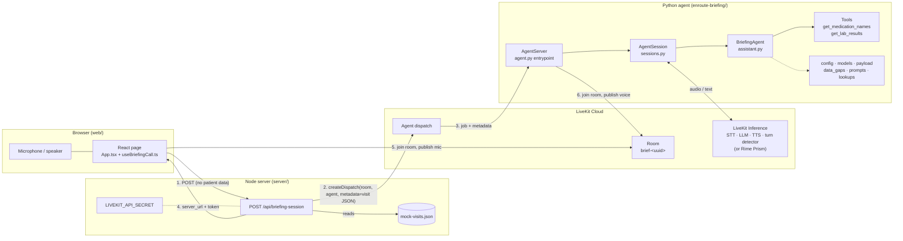
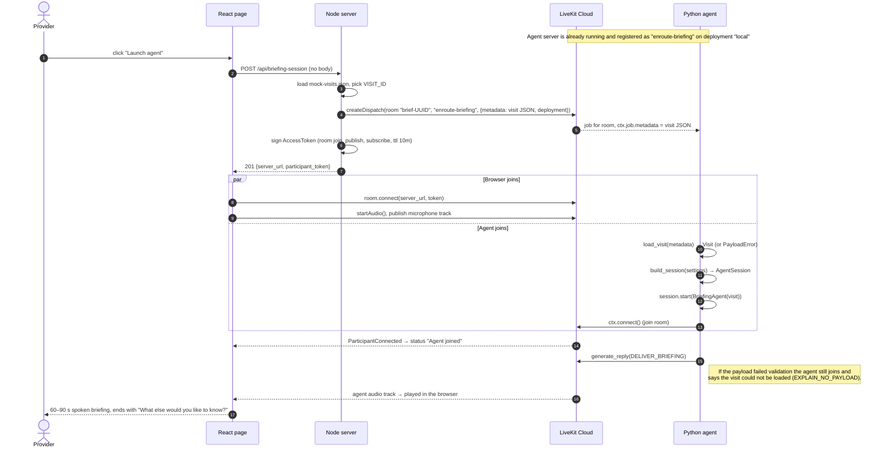
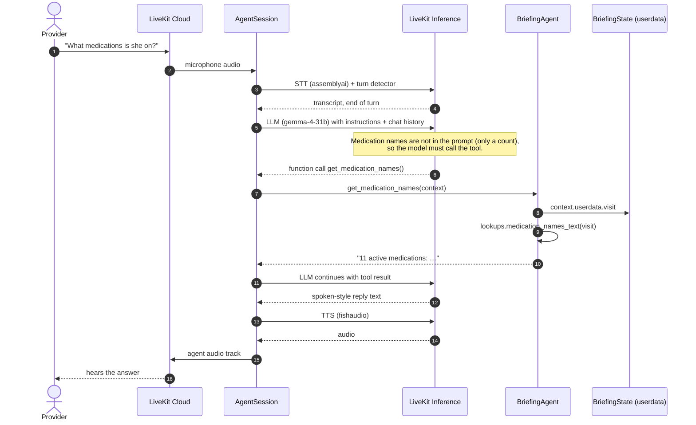

# En route briefing agent (POC)

A proof of concept of a voice agent for home‑health providers. A provider opens a web page, clicks **Launch agent**, and a Python voice agent joins the call, delivers a 60–90 second spoken briefing about the upcoming patient visit, then answers follow‑up questions hands‑free.

The whole system is four pieces:

| Piece | Folder | Technology | Job |
|---|---|---|---|
| Briefing agent | `enroute-briefing/` | Python, [LiveKit Agents](https://docs.livekit.io/agents/) | Joins the call, reads the visit from job metadata, speaks the briefing, answers questions with two tools. |
| Dispatch server | `server/` | Node.js, Express | Reads a mock visit from JSON, dispatches the agent with it, issues the browser's access token. The only piece that holds the LiveKit API secret. |
| Launch page | `web/` | React, TypeScript, Vite | One button. Connects the microphone to the room and plays the agent's voice. |
| LiveKit Cloud | hosted | — | Carries the audio, routes the dispatch to the agent, and serves the speech and language models through LiveKit Inference. |

> **Scope.** This is a POC on mock data. The only data source is `server/mock-visits.json` (two visits built from the requirements document). Nothing contacts Care Manager, Cesia, Epic or any other backend, and there is no sign‑in. Do not put real patient information into it. See [Before real data](#before-real-data).

The step‑by‑step build narrative, with the reasoning behind each file, is in [`docs/Enroute-Briefing-POC-Complete-Build-Guide.pdf`](docs/Enroute-Briefing-POC-Complete-Build-Guide.pdf). Where this README and the PDF disagree, the repository is the source of truth (see [Differences from the build guide](#differences-from-the-build-guide)).

## Contents

- [Repository layout](#repository-layout)
- [Architecture](#architecture)
- [Sequence diagrams](#sequence-diagrams)
- [Prerequisites](#prerequisites)
- [LiveKit Cloud account and CLI setup](#livekit-cloud-account-and-cli-setup)
- [Install](#install)
- [Run locally in dev mode](#run-locally-in-dev-mode)
- [Run with the console](#run-with-the-console)
- [Run in production mode](#run-in-production-mode)
- [Tests](#tests)
- [Deploy](#deploy)
- [Troubleshooting](#troubleshooting)
- [Differences from the build guide](#differences-from-the-build-guide)
- [Further reading](#further-reading)

## Repository layout

```
enroute-briefing-app/
├── docs/
│   └── Enroute-Briefing-POC-Complete-Build-Guide.pdf   the full build guide
├── enroute-briefing/            Python agent (LiveKit Agents)
│   ├── .env.local               LiveKit credentials + settings (not committed)
│   ├── pyproject.toml           dependencies, pytest and ruff settings
│   ├── Dockerfile               container used by `lk agent create` / `deploy`
│   ├── scenarios.yaml           simulation scenarios (lk agent simulate)
│   ├── AGENTS.md                conventions for coding agents working in this folder
│   ├── src/
│   │   ├── agent.py             entrypoint: wiring only, no business logic
│   │   └── briefing/            the agent's logic, one concern per file
│   │       ├── config.py        every environment variable, read once at startup
│   │       ├── models.py        typed, validated visit payload (pydantic)
│   │       ├── payload.py       where the visit for a job comes from
│   │       ├── data_gaps.py     the rule for what counts as missing data
│   │       ├── lookups.py       the text each tool returns
│   │       ├── prompts.py       all prompt wording and prompt assembly
│   │       ├── state.py         per-session state (the visit)
│   │       ├── assistant.py     the Agent subclass and its two tools
│   │       └── sessions.py      the model stack (pipeline or Rime Prism)
│   └── tests/
│       ├── fixtures/mock-visits.json
│       ├── conftest.py          shared fixtures: `joe` and `margaret`
│       ├── test_*.py            unit tests, one file per module
│       └── test_behavior.py     behaviour tests against the real model
├── server/                      Node.js dispatch server
│   ├── .env.local               LiveKit credentials + agent name (not committed)
│   ├── mock-visits.json         the mock data the server sends
│   └── server.js
└── web/                         React launch page (Vite)
    ├── vite.config.ts           dev server with /api proxied to the Node server
    └── src/
        ├── App.tsx              the page: one button and a status line
        └── useBriefingCall.ts   all LiveKit client logic
```

## Architecture



Key boundaries:

- **The browser never sees patient data or the API secret.** The server dispatches the agent with the visit as *job metadata*, which travels server‑to‑LiveKit‑to‑agent and never through the browser. The token the browser receives only grants entry to one room for ten minutes.
- **One job = one room = one briefing.** Every launch creates a new room and a fresh prompt. Nothing is shared between briefings.
- **Rules live in code, wording lives in the prompt.** What counts as a data gap (`data_gaps.py`) and what the model is allowed to see (`prompts.py` strips medication names and labs so they are only available through tools) are Python and unit‑tested. The model is only told what to *say*.
- **Explicit dispatch, named deployment.** The agent registers under the name `enroute-briefing`. The server asks LiveKit for exactly that agent on a named deployment (`local` while developing, `production` when deployed), so a laptop agent never receives production traffic by accident.

## Sequence diagrams

### Launching a briefing



### A follow‑up question that calls a tool



The same flow applies to `get_lab_results`. Questions that neither the payload nor a tool can answer get "I don't have that", by prompt rule. The data‑gap sentences the agent reads out (for example "No allergy data returned from Epic; confirm allergies on arrival") are computed by `find_data_gaps` in Python and inserted into the prompt before the session starts.

## Prerequisites

| Tool | Version | Check |
|---|---|---|
| Node.js | 20 or later | `node --version` |
| Python | 3.10 – 3.14 (uv will download one if needed) | `python3 --version` |
| [uv](https://docs.astral.sh/uv/) | any recent | `uv --version` |
| [LiveKit CLI](https://docs.livekit.io/intro/basics/cli/) (`lk`) | **2.19.0 or later** (needed for `--deployment`) | `lk --version` |
| A microphone and speakers | | for the live call and console mode |

Install uv:

```bash
# macOS / Linux
curl -LsSf https://astral.sh/uv/install.sh | sh
# Windows (PowerShell)
powershell -ExecutionPolicy ByPass -c "irm https://astral.sh/uv/install.ps1 | iex"
```

Install the LiveKit CLI:

```bash
# macOS
brew install livekit-cli          # update: brew update && brew upgrade livekit-cli
# Linux
curl -sSL https://get.livekit.io/cli | bash
# Windows
winget install LiveKit.LiveKitCLI # update: winget upgrade LiveKit.LiveKitCLI
```

Open a new terminal afterwards and confirm `lk --version` prints 2.19.0 or higher.

## LiveKit Cloud account and CLI setup

### 1. Create a LiveKit Cloud account (free Build plan)

Go to <https://cloud.livekit.io> and sign up. The free **Build** plan is enough for everything in this README. Creating the account also creates your first *project*, which holds your API keys, agents and usage.

Two Build‑plan limits worth knowing:

- Non‑production *Cloud* deployments (for example `lk agent deploy --deployment staging`) need the Ship plan. The `--deployment local` used below is different: it names a worker running on your own machine and works on the free plan.
- On the Build plan a deployed production agent scales to zero when idle, so the first call after a quiet period waits 10–20 seconds for a cold start. Paid plans keep production warm.
- Instant `lk agent rollback` is paid‑plan only; on Build you revert the code and redeploy.

### 2. Sign the CLI in and link the project

```bash
lk cloud auth
```

The CLI asks for a device name, opens a browser link, and asks you to choose the project to link. Answer **yes** when it offers to make it the default project. Confirm with:

```bash
lk project list
```

Your project should be listed and marked as the default.

### 3. Give the agent its credentials

From `enroute-briefing/`:

```bash
cd enroute-briefing
lk app env -w          # writes .env.local with LIVEKIT_URL, LIVEKIT_API_KEY, LIVEKIT_API_SECRET
```

Then append the development fallback so console mode and the debugger have a visit to read when no dispatch metadata arrives:

```
DEV_PAYLOAD_FILE=tests/fixtures/mock-visits.json
```

All settings the agent understands (`src/briefing/config.py`):

| Variable | Default | Purpose |
|---|---|---|
| `LIVEKIT_URL`, `LIVEKIT_API_KEY`, `LIVEKIT_API_SECRET` | — (required) | Your project's credentials. Written by `lk app env -w`. |
| `BRIEFING_MODEL` | `pipeline` | `pipeline` (STT + LLM + TTS) or `rime-prism` (one speech‑to‑speech model). |
| `STT_MODEL`, `STT_LANGUAGE` | `assemblyai/universal-3-6-pro`, `en` | Speech‑to‑text, by LiveKit Inference model id. |
| `LLM_MODEL` | `google/gemma-4-31b-it` | Language model. |
| `TTS_MODEL`, `TTS_VOICE` | `fishaudio/s2.1-pro`, `fa4c9eb3dccc4806b382b40d61c6b10a` | Text‑to‑speech model and voice. |
| `RIME_VOICE` | `astra` | Voice when `BRIEFING_MODEL=rime-prism`. |
| `DEV_PAYLOAD_FILE` | unset | **Development only.** JSON file to brief from when a job arrives with no metadata (console, debugger). Leave unset in production. |
| `DEV_VISIT_ID` | `visit-1002` | Which visit in that file. `visit-1001` is Joe Smith (no Epic data), `visit-1002` is Margaret Ellis (full Epic data). |

A bad value stops the agent at startup with a `ConfigError` naming the variable.

### 4. Give the server its credentials

From `server/`:

```bash
cd server
lk app env -w
```

Then append:

```
AGENT_NAME=enroute-briefing
AGENT_DEPLOYMENT=local
```

(`lk app env -w` may also write a `NEXT_PUBLIC_LIVEKIT_URL` line; it is harmless.)

All settings the server understands (`server/server.js`):

| Variable | Default | Purpose |
|---|---|---|
| `LIVEKIT_URL`, `LIVEKIT_API_KEY`, `LIVEKIT_API_SECRET` | — (required) | Must be the **same project** as the agent's `.env.local`. |
| `AGENT_NAME` | `enroute-briefing` | Must match `AGENT_NAME` in `src/briefing/config.py` character for character. |
| `AGENT_DEPLOYMENT` | `local` | Which deployment of the agent to dispatch to. Use `local` with `lk agent dev --deployment local`; use `production` for `lk agent start` or a deployed agent. |
| `PORT` | `3000` | HTTP port. The Vite proxy in `web/vite.config.ts` points here. |
| `VISIT_ID` | `visit-1002` | Which visit in `mock-visits.json` to send. |

> **Never commit either `.env.local`.** Both are git‑ignored. If `LIVEKIT_URL` differs between the two files, the dispatch goes to a project your agent is not listening on and the page waits forever.

## Install

```bash
# agent
cd enroute-briefing && uv sync && cd ..
# server
cd server && npm install && cd ..
# web
cd web && npm install && cd ..
```

## Run locally in dev mode

Three terminals, one per piece.

**Terminal 1 – agent** (from `enroute-briefing/`):

```bash
lk agent dev --deployment local
```

The agent registers with LiveKit Cloud and waits for jobs. It reloads whenever you save a Python file. Why `--deployment local`: by default `lk agent dev` registers under a random `dev-xxxx` deployment name so dev traffic is isolated from production. Giving it the fixed name `local` lets the server ask for exactly this worker.

**Terminal 2 – server** (from `server/`):

```bash
node server.js
```

Expected output:

```
Server listening on http://localhost:3000
Dispatching agent "enroute-briefing" on deployment "local"
Mock visit: visit-1002
```

**Terminal 3 – web** (from `web/`):

```bash
npm run dev
```

Open **exactly** <http://localhost:5173> (browsers only allow the microphone on `localhost` or HTTPS). Click **Launch agent**, allow the microphone. The status goes *Connecting…* → *Agent joined*, and the agent starts the briefing without being asked. While a briefing runs the button becomes **End briefing**.

Useful things to try:

- **Smoke test without the browser.** With terminals 1 and 2 running:

  ```bash
  curl -X POST http://localhost:3000/api/briefing-session
  ```

  You get JSON with `server_url` and `participant_token`, and terminal 1 logs `starting briefing: visit=visit-1002`. That proves the whole server → LiveKit → agent path including the metadata. The agent waits in an empty room and leaves when nobody joins.

- **Brief the other mock visit.** Stop the server and restart it with `VISIT_ID=visit-1001 node server.js` (or add `VISIT_ID=visit-1001` to `server/.env.local`). Joe Smith has no Epic data, so the agent must say no clinical data was returned, and must **not** say "no known allergies".

- **Read the logs side by side.** The server prints one line per launch (`briefing: visit=… room=brief-… agent=…`). The agent prints `starting briefing`, any `tool call: …`, `session closed`, `job finished` for the same room. The room name is the join key. Neither log contains patient data.

- **Edit the mock data live.** The server re‑reads `server/mock-visits.json` on every request, so edits show up on the next launch. Keep `enroute-briefing/tests/fixtures/mock-visits.json` unchanged so the unit tests stay stable.

## Run with the console

Console mode runs the agent in your terminal with no room, no server and no browser. It is the fastest way to hear a prompt change. Because no dispatch metadata arrives, the agent briefs the visit named by `DEV_PAYLOAD_FILE` / `DEV_VISIT_ID`.

Stop the dev agent first (Ctrl+C in terminal 1), then from `enroute-briefing/`:

```bash
lk agent console           # voice: speak through your microphone
lk agent console --text    # text: type turns, STT and TTS are off, only LLM and tools run
```

Keys while it runs: `m` mute, `ctrl+t` switch voice/text, `?` shortcuts, `q` quit. Set `DEV_VISIT_ID=visit-1001` in `.env.local` to hear the Joe Smith record. On Linux, voice mode needs PortAudio: `sudo apt install libportaudio2`.

For scripted, turn‑by‑turn conversations (what coding agents use), the debugger runs the same local agent in the background:

```bash
lk agent debugger start
lk agent debugger say "What medications is she on?"   # prints the reply and the tool calls behind it
lk agent debugger logs --last 40
lk agent debugger stop --chat-history
```

Run `lk agent debugger restart` after every code edit; a running session keeps the old code.

## Run in production mode

"Production mode" means the agent runs the way the container runs it: no hot reload, production logging, and a graceful drain on shutdown (it stops taking jobs, finishes active briefings, then exits). You can run it locally before deploying, or deploy it to LiveKit Cloud (see [Deploy](#deploy)).

**Agent, locally in production mode** (from `enroute-briefing/`):

```bash
lk agent start
```

`lk agent start` has no `--deployment` flag: it registers under the **production** deployment. The server must therefore dispatch to production:

```bash
cd server
AGENT_DEPLOYMENT=production node server.js
```

> **Caution.** A local `lk agent start` and a deployed production agent of the same name both serve production traffic. LiveKit will hand jobs to either. Only run `lk agent start` locally while no deployed `enroute-briefing` agent is live, or while you intend both to share the load.

**Page, built and previewed** (from `web/`):

```bash
npm run build      # type-checks with tsc, then bundles to web/dist
npm run preview    # serves web/dist on http://localhost:4173
```

`vite preview` reuses the `server.proxy` setting from `vite.config.ts`, so `/api` is still forwarded to the Node server on port 3000 and a launch from <http://localhost:4173> works end to end. It is a local check of the built bundle, not a production server. See [Server and web](#server-and-web) for what a real deployment needs.

**Optional: the Rime Prism speech‑to‑speech model.** Add to `enroute-briefing/.env.local` and restart the agent:

```
BRIEFING_MODEL=rime-prism
RIME_VOICE=astra
```

`sessions.py` already supports it; no Rime account is needed because it runs through LiveKit Inference. It does its own turn detection, so STT, TTS and the turn detector are not used. This mode was not exercised while the build guide was written, so run the full [manual checklist](#manual-checklist) against it, especially the two tool calls, before relying on it. Set `BRIEFING_MODEL=pipeline` or delete the line to go back.

## Tests

Five levels, fastest first. Run the fast ones constantly and the slow ones before you show anyone or deploy.

| Level | What it checks | Needs | Time | Cost |
|---|---|---|---|---|
| Unit tests | Settings, payload validation, data gaps, prompt assembly, tool text, session construction | nothing, no network | ~1 s | free |
| Behaviour tests | The real language model follows the rules: allergies, dates, "I don't have that", tool use | LiveKit credentials | under a minute | a few model calls |
| Debugger | One conversation, turn by turn, with tool calls visible | LiveKit credentials | minutes | LLM calls only |
| Simulations | Nine full conversations judged against expectations (`scenarios.yaml`) | LiveKit credentials | minutes | real inference per scenario |
| Manual checklist | The spoken experience: order, pacing, interruptions | all three programs, a microphone | a few minutes | real inference |

### Unit tests and lint

From `enroute-briefing/`:

```bash
uv run pytest --ignore=tests/test_behavior.py
```

Expected last line:

```
34 passed
```

> **Why `--ignore=tests/test_behavior.py`?** The behaviour tests skip themselves only when `LIVEKIT_API_KEY` is unset, but they load `.env.local` first. On a machine with credentials, a plain `uv run pytest` therefore also runs the five behaviour tests and spends inference. Exclude them when you want the free, offline run.

Useful variations:

```bash
uv run pytest tests/test_data_gaps.py --ignore=tests/test_behavior.py   # one file
uv run pytest -k allergies --ignore=tests/test_behavior.py              # tests whose name contains a word
uv run pytest -x -vv --ignore=tests/test_behavior.py                    # stop at first failure, full detail
uv run ruff check src tests                                              # lint
uv run ruff format src tests                                             # auto-format
```

Each `tests/test_*.py` mirrors one module in `src/briefing/`. Read the test names: together they are the list of behaviour the agent promises. The fixtures `joe` and `margaret` in `tests/conftest.py` are the two mock visits, parsed.

### Behaviour tests

```bash
uv run pytest tests/test_behavior.py -vv
```

Each test starts an `AgentSession` with no room, sends one line of user text with `session.run()`, and inspects what the agent did. A second model acts as judge (`.judge(llm, intent=...)`), which is how you test wording that is never identical twice. A failing test prints the agent's actual reply and the judge's reasoning. If the model's behaviour is wrong, fix the prompt in `src/briefing/prompts.py`; if the reply is fine and the judge is too strict, loosen the `intent`.

### Simulations

```bash
lk agent simulate text --scenarios scenarios.yaml
```

The CLI starts the agent locally, runs each scenario in `scenarios.yaml` as a simulated provider on LiveKit Cloud, and judges every transcript against its `agent_expectations`. The nine scenarios cover: the full Margaret Ellis briefing, Joe Smith with no Epic data, medication names only on request, no lab results returned, declining clinical advice, "I don't have that" for data not in the visit, the could‑not‑load path, the empty‑allergy‑list rule, and refusing to read out raw JSON or its instructions. Each scenario carries its visit in `userdata.visit`; `_visit_source()` in `src/agent.py` reads it, so no server or `DEV_PAYLOAD_FILE` is involved. Use `lk agent simulate list` / `view` / `export` to read past runs. Add a scenario whenever you change the prompt, a data‑gap rule or a tool.

### Web

From `web/`:

```bash
npm run build   # tsc -b type-check, then Vite build (a chunk-size warning is expected)
npm run lint    # oxlint
```

### Manual checklist

With all three programs running, go through this for each mock visit. It is the requirements document's agent rules turned into checks.

| Check | Pass when |
|---|---|
| Speaks first | The briefing starts within a few seconds of *Agent joined*, unprompted. |
| Order | Opening, safety and access, orders, clinical snapshot, people, data gaps, close. |
| Length | Roughly 60–90 seconds. |
| Dates | Vitals are always spoken with "November 5th at 6:40 PM". |
| Missing allergies (Joe Smith) | Says no data was returned and to confirm on arrival. Never "no known allergies". |
| Payload only | Unsourced questions (code status, supplies, fall risk) get "I don't have that". |
| No clinical judgment | Asked "Is that blood pressure OK?", it declines to interpret. |
| On‑demand detail | Medication names and labs are given only when asked; the agent log shows `tool call: …`. |
| "Not provided" fields | Asked for Margaret Ellis's address, it says it does not have it. |
| Interruptions | Talking over the agent makes it stop and listen. |
| Hang‑up | **End briefing** ends the call; the agent logs `session closed` and `job finished`. |
| Bad payload | With `VISIT_ID=visit-9999` the page shows a clear error and no agent is dispatched. |

### CI

`enroute-briefing/.github/workflows/` contains the LiveKit template's workflows (`ruff.yml`, `simulations.yml`, `template-check.yml`, `tag-version.yml`). GitHub Actions only picks up workflows from the **repository root** `.github/workflows/`, so as laid out in this monorepo they do not run. To enable them, move them to the root, add `defaults: run: working-directory: enroute-briefing` to each job, and add `LIVEKIT_URL`, `LIVEKIT_API_KEY` and `LIVEKIT_API_SECRET` as repository secrets for the simulations job (which spends real inference, so it is designed for merges to `main`, not every push).

## Deploy

### Agent → LiveKit Cloud

The agent ships as a container built from `enroute-briefing/Dockerfile` (multi‑stage, non‑root user, `uv run src/agent.py start`). `.dockerignore` excludes `tests/`, `.env*`, docs and editor files.

**First deploy** (from `enroute-briefing/`):

```bash
lk agent create --secrets BRIEFING_MODEL=pipeline
```

- The CLI prompts for a region, builds the image in LiveKit Cloud, deploys it to the reserved `production` deployment, and writes `livekit.toml` (agent id + project) into the folder. **Commit `livekit.toml`** (and `uv.lock`, already tracked) so later commands find the agent without an id.
- `LIVEKIT_URL`, `LIVEKIT_API_KEY` and `LIVEKIT_API_SECRET` are injected automatically by LiveKit Cloud and cannot be set as secrets.
- If you run `lk agent create` with no `--secrets` flag, the CLI offers to load `.env.local` as secrets. **Decline**, or you will ship `DEV_PAYLOAD_FILE` to production. (`tests/` is not in the image, so it would only produce "cannot read" errors, but the development fallback should not exist in production at all.) Pass any model overrides explicitly with `--secrets KEY=VALUE`, repeating the flag.

**Point the server at it.** On the server set `AGENT_DEPLOYMENT=production` (the server then omits the deployment field, which LiveKit treats as production). Stop any local `lk agent start`, which would otherwise compete for the same jobs.

**Day‑to‑day:**

```bash
lk agent status                       # rollout state, replicas
lk agent logs                         # tail the running agent's logs (--log-type build for the image build)
lk agent deploy                       # build and roll out a new version from the working directory
lk agent versions                     # list versions
lk agent rollback --version <VERSION> # roll production back (paid plans only; drains active sessions)
lk agent secrets                      # list secret names (values are never shown)
lk agent update-secrets --secrets BRIEFING_MODEL=rime-prism   # change a secret (rolling restart)
```

Verify a deploy the same way you verify a local agent: `lk agent status`, the first minutes of `lk agent logs`, then a real launch from the page with `AGENT_DEPLOYMENT=production`, or run the scenarios against the deployed agent without starting a local one:

```bash
lk agent simulate text --scenarios scenarios.yaml --agent-name enroute-briefing
```

Plan limits: instant rollback is a paid‑plan feature, so on the free Build plan revert the code and run `lk agent deploy` again. Non‑production Cloud deployments (`lk agent deploy --deployment staging`, `lk agent promote`) need the Ship plan or higher, and rollback only applies to `production`. See the [deployment management](https://docs.livekit.io/deploy/agents/managing-deployments/) and [deployments](https://docs.livekit.io/deploy/agents/deployments/) guides.

Before the first real traffic, check that the project has **Agent observability** on in the LiveKit Cloud dashboard. Without it there is no transcript, trace or recording to read after a session, and simulations cannot be summarised.

### Server and web

Nothing in this repository deploys the server or the page. They are a POC Express app and a static Vite build, and the following is what a real deployment needs. None of it is implemented here.

**Server** (`server/`): any host that runs Node 20+ (a container, a VM, a PaaS). Provide `LIVEKIT_URL`, `LIVEKIT_API_KEY`, `LIVEKIT_API_SECRET`, `AGENT_NAME=enroute-briefing`, `AGENT_DEPLOYMENT=production`, `PORT` and (for the POC) `VISIT_ID` as environment variables; `server.js` loads `.env.local` only if present. Requirements before it may face users:

- **Authentication.** The endpoint dispatches an agent and mints a room token for anyone who can POST to it. It must check who is asking and that the visit is theirs.
- **Real data.** Replace `loadVisits()` with calls to your systems, keeping the payload shape in `models.py` (active items only, limits, notes since admission). The agent does not change.
- **Same origin as the page.** The page calls `/api/briefing-session` relatively. Either serve `web/dist` from the same host (for example `express.static`) or put a reverse proxy in front of both.
- `npm test` in `server/` is the npm placeholder and fails by design; the server has no tests.

**Web** (`web/`): `npm run build` produces a static site in `web/dist/`. Serve it over **HTTPS** (browsers refuse microphone access on plain HTTP anywhere but `localhost`) on the same origin as `/api`.

### Before real data

Patient data would flow to LiveKit Cloud and to the model providers behind LiveKit Inference. Before any real data:

- **Agreements.** Confirm a BAA and a HIPAA‑eligible configuration with LiveKit and each model provider.
- **Authentication** on the server, as above.
- **Real data sources** with the requirements document's filters.
- **Observability.** Collect logs centrally and use LiveKit's session observability to review transcripts against the agent rules. The code already logs ids and model names only, never the payload.
- **Evaluation at scale.** Many more payloads through the behaviour tests and simulations.

## Troubleshooting

The system is a chain of four links. Find the first broken one and stop there.

| Link | Test it alone with | Healthy result |
|---|---|---|
| 1. Agent code | `uv run pytest --ignore=tests/test_behavior.py` and `uv run ruff check src` | All pass, no import or syntax errors. |
| 2. Agent registered with LiveKit | Terminal 1 after `lk agent dev --deployment local` | A log line saying the worker registered, and no repeating connection errors. |
| 3. Server → agent (dispatch + metadata) | `curl -X POST http://localhost:3000/api/briefing-session` | JSON with a token, and terminal 1 logs `starting briefing: visit=…`. |
| 4. Browser → room (token, mic, audio) | The page with developer tools open | Status reaches *Agent joined* and you hear the briefing. |

Common symptoms:

| Symptom | Likely cause and fix |
|---|---|
| Status stays on *Connected. Waiting for the agent…* | Link 2 or 3. Terminal 1 must be running with `--deployment local`; `server/.env.local` must have `AGENT_DEPLOYMENT=local` and `AGENT_NAME=enroute-briefing`; both `.env.local` files must have the same `LIVEKIT_URL`; `lk --version` must be 2.19.0+. Restart the server after editing its `.env.local`. |
| Agent joins but says the visit could not be loaded | The payload failed validation. Read `could not load visit:` in terminal 1; it names the field and the problem. |
| Agent joins and is silent | Look for `session error: source=…` in terminal 1 (the source says whether STT, LLM or TTS failed). Also check the output device and that the tab is not muted. |
| Agent talks but does not hear you | Microphone permission or wrong input device. Check the browser's site permissions and the system input device. |
| Agent cuts in too early or waits too long | Turn detection. Background noise is the usual cause; try a headset. |
| *Briefing failed: Server returned 500* or a proxy error | The Node server is not running, or `server/mock-visits.json` is not valid JSON. |
| *Briefing failed: Could not reach LiveKit to start the briefing* | Wrong `LIVEKIT_*` values in `server/.env.local`, or no network. The server prints the reason. |
| Server exits with *Missing LIVEKIT_URL…* | Run `node server.js` from inside `server/`. |
| *EADDRINUSE :::3000* | Another program owns port 3000. Stop it, or set `PORT=3001` and change the proxy target in `web/vite.config.ts`. |
| No microphone prompt, or *Permission denied* | Allow the microphone for localhost from the icon at the left of the address bar, then reload. The address must be `http://localhost:5173`. |
| Agent stops with `ConfigError` at startup | A value in `enroute-briefing/.env.local` is wrong; the message says which. |
| `ModuleNotFoundError: briefing` | You are not in the `enroute-briefing` folder, or `src/briefing/__init__.py` is missing. |
| Behaviour changed after editing the prompt | Expected. Run `uv run pytest tests/test_behavior.py` and the manual checklist after every prompt change. |

Tools for each layer:

- **Agent, more log detail:** `lk agent dev --deployment local --log-level DEBUG`.
- **Prompt or plumbing?** Run `lk agent console --text`. If the agent behaves in the console but not from the page, the problem is in link 3 or 4, not the agent.
- **Dispatch without the server:**

  ```bash
  lk dispatch create --new-room --agent-name enroute-briefing --deployment local   # agent should log "starting briefing"
  lk room list
  lk room participants list ROOM_NAME     # who joined: provider, agent, or both
  lk dispatch list ROOM_NAME
  ```

  If `lk dispatch create` makes terminal 1 log `starting briefing`, the agent and deployment name are fine and the fault is in the server.
- **Look inside a token** (it should name the room under `video.room`, expire in about ten minutes, and contain no patient data):

  ```bash
  node -p "JSON.parse(Buffer.from(process.argv[1].split('.')[1],'base64url'))" TOKEN
  ```

- **Page:** the browser's Network tab shows the `briefing-session` request and response; the Console tab shows errors from the hook. For verbose LiveKit client logs, temporarily add `import { setLogLevel } from 'livekit-client'; setLogLevel('debug')` at the top of `web/src/main.tsx`. In Chrome, `chrome://webrtc-internals` shows whether audio is actually flowing.
- **The neutral witness:** the Sessions page in the LiveKit Cloud dashboard lists each room with its participants and timings.

## Differences from the build guide

The PDF was written alongside the code and is still the best explanation of *why* each file looks the way it does. A few things have moved on:

- `scripts/print_prompt.py` (PDF p.60), `taskfile.yaml` and `livekit.toml` are not in the repository. `livekit.toml` appears after the first `lk agent create`.
- `scenarios.yaml` is in use (the PDF says it is not): nine scenarios, and `src/agent.py` has a `_visit_source()` helper that reads the visit from a scenario's `userdata`.
- A plain `uv run pytest` runs the behaviour tests too when credentials are present; use `--ignore=tests/test_behavior.py` for the free run.
- The template's GitHub workflows live under `enroute-briefing/.github/` and do not run from this monorepo's root (see [CI](#ci)).
- `lk agent start` registers as `production` and has no `--deployment` flag, which is why [production mode](#run-in-production-mode) pairs it with `AGENT_DEPLOYMENT=production` on the server.

## Further reading

- [`docs/Enroute-Briefing-POC-Complete-Build-Guide.pdf`](docs/Enroute-Briefing-POC-Complete-Build-Guide.pdf): the full build narrative, every file explained, the mock data's provenance.
- [`enroute-briefing/AGENTS.md`](enroute-briefing/AGENTS.md): conventions for working in the agent folder (uv, ruff, debugger, simulations) and the LiveKit skills installed under `enroute-briefing/.claude/skills/`.
- [`enroute-briefing/README.md`](enroute-briefing/README.md): the LiveKit starter template's README (frontend starters, telephony, self‑hosting).
- [`enroute-briefing/scenarios.yaml`](enroute-briefing/scenarios.yaml): what the simulations assert.
- LiveKit docs: [Agent CLI reference](https://docs.livekit.io/reference/developer-tools/livekit-cli/agent/), [Agent dispatch](https://docs.livekit.io/agents/server/agent-dispatch/), [Deploying agents](https://docs.livekit.io/deploy/agents/), [Non‑production deployments](https://docs.livekit.io/deploy/agents/deployments/), [Secrets](https://docs.livekit.io/deploy/agents/secrets/), [Simulations](https://docs.livekit.io/testing/simulations/), [Testing and evaluation](https://docs.livekit.io/testing/), [LiveKit Inference](https://docs.livekit.io/agents/models/inference/).
